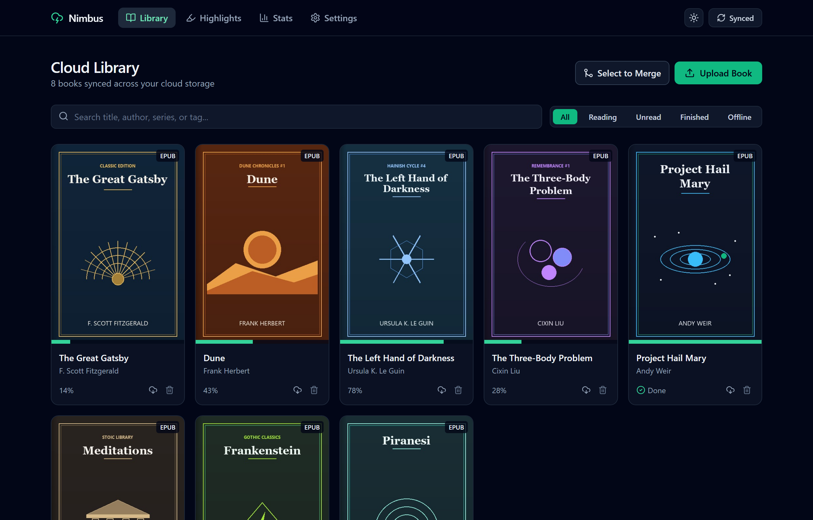
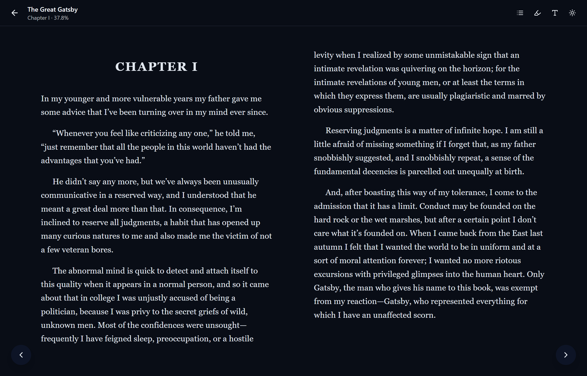
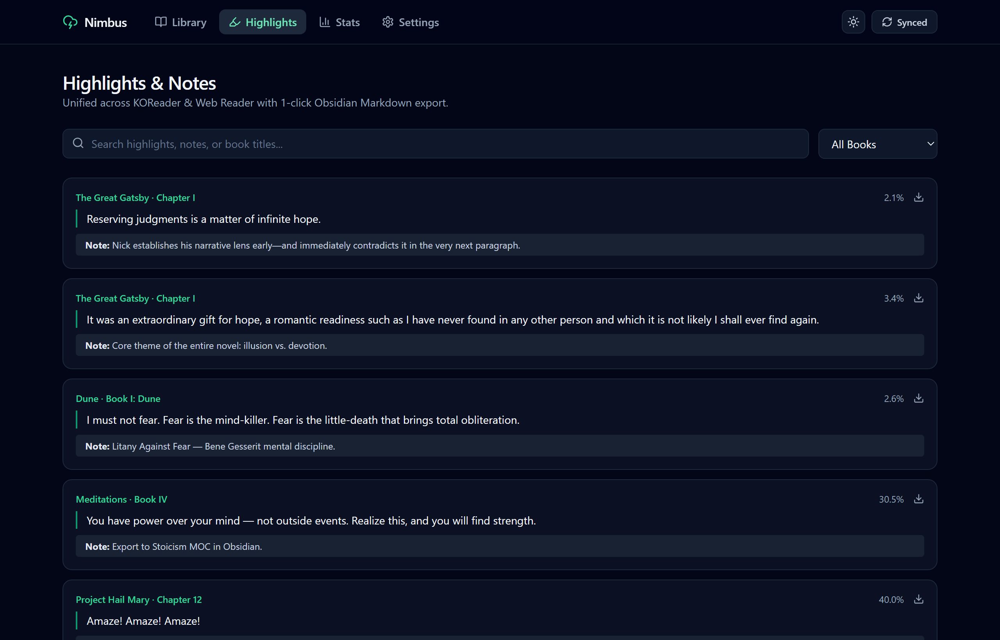
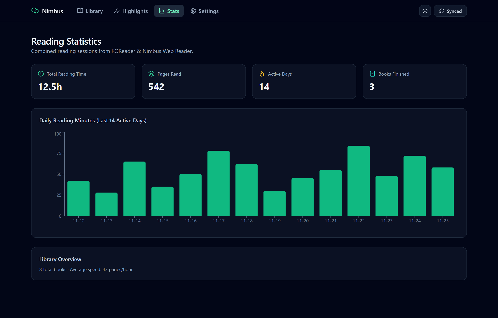
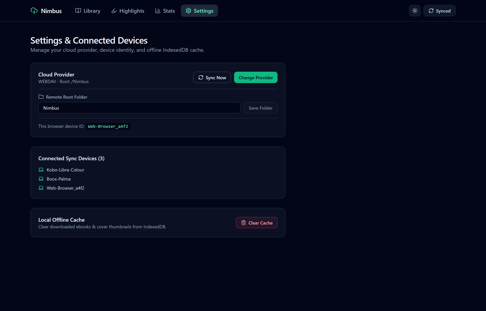
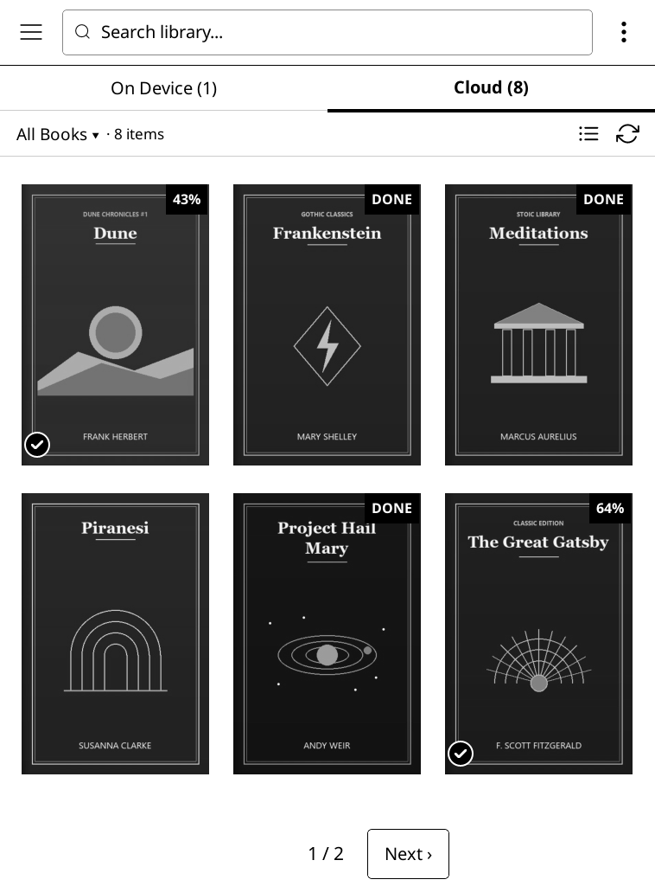
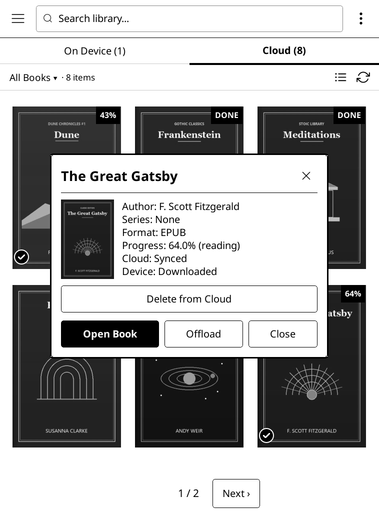
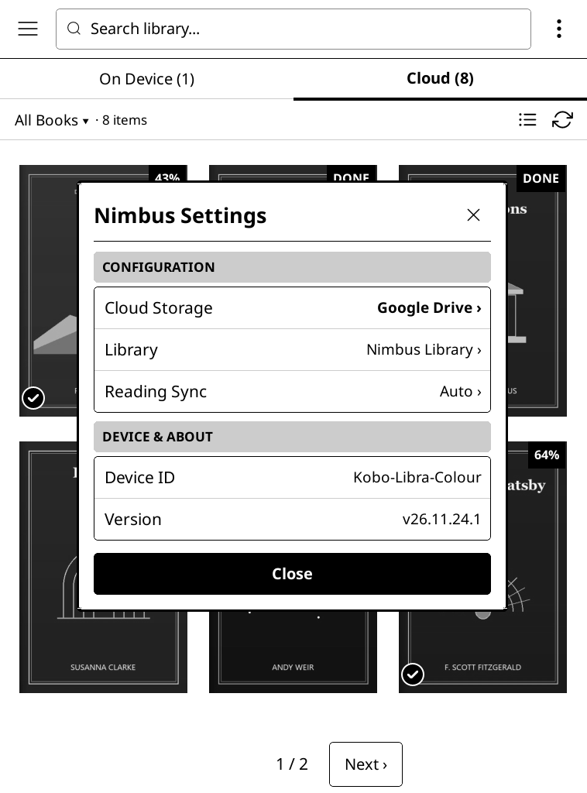
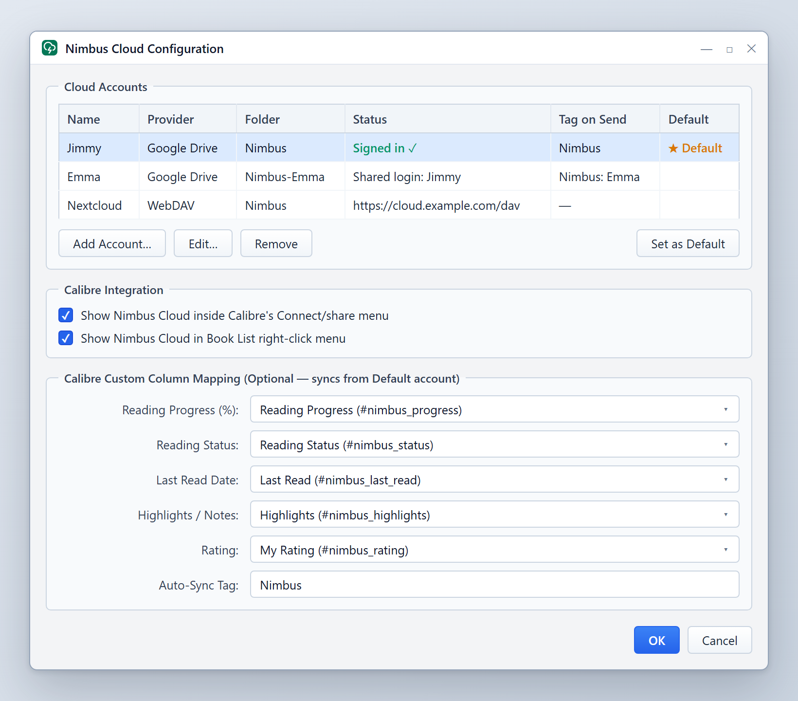
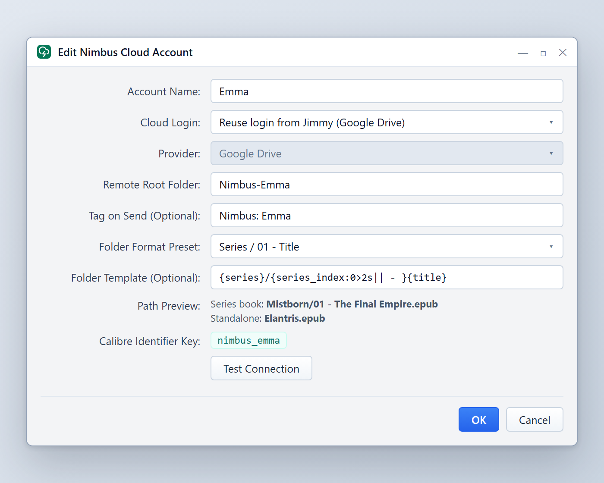

# Nimbus

**Zero-self-hosting, cloud-native ebook library, reading sync, highlights, and reading statistics across KOReader, Calibre, and the Web.**

Nimbus uses your own cloud storage (**Google Drive**, **OneDrive**, **Dropbox**, or **WebDAV**) as the single source of truth — no VPS, no self-hosted database, and no third-party file servers.

## Screenshots

### Web App (PWA)

| Built-in EPUB/PDF Reader | Highlights & Obsidian Export |
| :---: | :---: |
|  |  |

| Reading Statistics Dashboard | Settings & Connected Devices |
| :---: | :---: |
|  |  |

### KOReader Plugin (`nimbus.koplugin`)

| Cloud Library & Home Screen | Book Details & Actions | Nimbus Settings |
| :---: | :---: | :---: |
|  |  |  |

### Calibre Companion Plugin (`NimbusCalibre`)

| Multi-Account & Custom Columns | Shared Login & Folder Templates |
| :---: | :---: |
|  |  |

## Monorepo Structure

- [`spec/`](spec/SCHEMA.md) — Shared Cloud Storage Layout, JSON Schemas (v1), `partial_md5` hashing spec, and cross-language golden merge fixtures.
- `koreader/nimbus.koplugin/` — Standalone KOReader plugin (cross-device reading sync, highlights/notes, `statistics.sqlite3` sync, Cloud Library browser).
- `calibre/` — Calibre Companion Plugin (`NimbusCalibre.zip`) with Direct Cloud API push/pull to custom columns.
- `web/` — Serverless React + TypeScript + Tailwind PWA (`foliate-js` + `pdf.js` + IndexedDB offline cache). Live at **[ultimatejimmy.github.io/nimbus](https://ultimatejimmy.github.io/nimbus/)**.

## Web App

Open the hosted PWA directly in your browser (desktop or mobile, no installation required):
- **[https://ultimatejimmy.github.io/nimbus/](https://ultimatejimmy.github.io/nimbus/)**

## Supported Cloud Providers (100% Parity)

- **Google Drive** (via `drive.file` OAuth scope)
- **Microsoft OneDrive** (via Microsoft Graph)
- **Dropbox** (via Dropbox API v2)
- **WebDAV** (Nextcloud, Synology, Koofr, etc.)

## Privacy & Security

- **Zero Nimbus Servers**: Nimbus has no backend, relay, or analytics server. Every client (KOReader, Calibre, and the Web App) communicates directly with your chosen cloud provider.
- **Local-Only Credentials**: Your OAuth tokens and WebDAV credentials are saved **only locally** on your device (KOReader `settings/nimbus/`, Calibre plugin config, or browser `localStorage` in the Web App). They are never transmitted to any Nimbus server and are never written to your cloud sync folder.
- **Minimal Permissions**: Google Drive uses the least-privilege `drive.file` scope, so Nimbus can only access the `/Nimbus` folder and files it creates or opens.

## Documentation

Full user guides and sync architecture docs are available in the **[Nimbus Wiki](https://github.com/ultimatejimmy/nimbus/wiki)**:

- [Quick Start](https://github.com/ultimatejimmy/nimbus/wiki/Quick-Start) & [Cloud Providers](https://github.com/ultimatejimmy/nimbus/wiki/Cloud-Providers)
- Client Guides: [KOReader Plugin](https://github.com/ultimatejimmy/nimbus/wiki/KOReader-Plugin) · [Calibre Plugin](https://github.com/ultimatejimmy/nimbus/wiki/Calibre-Plugin) · [Web App (PWA)](https://github.com/ultimatejimmy/nimbus/wiki/Web-App)
- [How Sync Works](https://github.com/ultimatejimmy/nimbus/wiki/How-Sync-Works) & [FAQ / Troubleshooting](https://github.com/ultimatejimmy/nimbus/wiki/FAQ-and-Troubleshooting)
