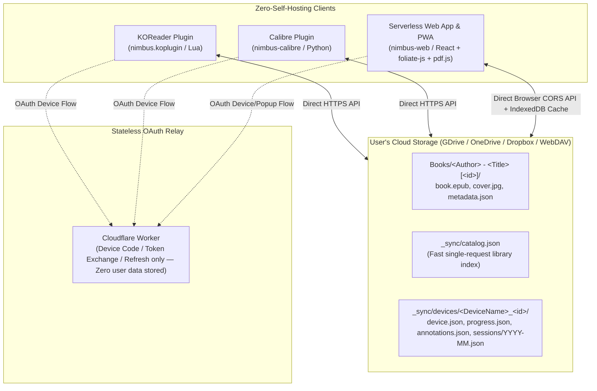

# Nimbus — Serverless BookOrbit Alternative Implementation Plan

## Goal Description

Build **Nimbus** (`C:\Users\Jimmy\Documents\nimbus`), a **zero-self-hosting alternative to BookOrbit** that uses a user's own cloud storage (**Google Drive, OneDrive, Dropbox, or WebDAV**) as the single source of truth across three first-class clients with 100% provider parity:

1. **KOReader Plugin (`nimbus.koplugin`)** — Reuses and extends the battle-tested cloud & OAuth engine from [backup_cloud.lua](file:///C:/Users/Jimmy/Documents/backup/backup.koplugin/backup.koplugin/backup_cloud.lua) to provide Whispersync-style reading progress sync, highlight/note sync, unified `statistics.sqlite3` session sync, and a Cloud Library browser with cover thumbnails, tap-to-download, and offload-to-save-space.
2. **Calibre Companion Plugin (`nimbus-calibre`)** — Connects directly to the same 4 cloud providers via Direct Cloud API (no desktop-sync folder quirks, full compatibility with Google Drive `drive.file` scope) to push curated books, covers, and metadata into the Nimbus Cloud Library and pull reading progress, reading status, and highlights back into configurable Calibre custom columns.
3. **Serverless Web App / PWA (`nimbus-web`)** — A 100% client-side static React + TypeScript + Tailwind PWA (hosted for free on Cloudflare Pages or GitHub Pages) with IndexedDB offline caching, a BookOrbit-style library dashboard, unified reading statistics & heatmaps, highlights explorer with Markdown/Obsidian export, and a built-in EPUB/CBZ/MOBI/PDF web reader (`foliate-js` + `pdf.js`) that syncs progress, highlights, and reading sessions directly to the user's cloud storage.

---

## User Review Required

> [!IMPORTANT]
> **Cloudflare OAuth Relay & Browser CORS Support**
> To reuse your existing OAuth apps and Cloudflare Worker (`backup.ultimatejimmy.workers.dev`) across all three clients — ensuring Google Drive `drive.file` visibility works seamlessly between KOReader, Calibre, and the Web App — we will add lightweight browser-CORS-safe `/api/oauth/gdrive/init` and `/api/oauth/onedrive/{init,poll,refresh}` pass-through endpoints to [worker.js](file:///C:/Users/Jimmy/Documents/backup/backup.koplugin/tools/relay/worker.js) (or a shared relay module). You will need to deploy the updated `worker.js` via `wrangler deploy` once Milestone 1 is ready for live browser testing.

> [!NOTE]
> **WebDAV CORS in Browser PWA**
> Google Drive, OneDrive, and Dropbox natively allow direct browser API calls via CORS. For WebDAV servers (e.g., Nextcloud, Synology, Koofr) that do not send `Access-Control-Allow-Origin` headers, the Web App will connect directly first and display clear setup instructions (plus an optional user-configurable CORS proxy URL in Advanced Settings — never routing credentials through a third-party server by default).

> [!NOTE]
> **Credential Reuse from `backup.koplugin`**
> `nimbus.koplugin` will ship as a completely standalone KOReader plugin (no hard dependency on `backup.koplugin`), while detecting `settings/backup_cloud_creds.lua` and `settings/backup_cloud_oauth.lua` to offer a **one-tap "Import Cloud Account from Device Backup & Restore"** flow. All OAuth client IDs and the relay URL will be isolated in `nimbus_constants.lua` (and matching constants in Calibre/Web) so you can later rebrand to dedicated Nimbus OAuth apps without architectural changes.

---

## System Architecture & Cloud Storage Specification

### High-Level Architecture



### Human-Readable, Scalable Hybrid Cloud Layout

Designed to be **clean and understandable when browsed manually** in Google Drive, OneDrive, Dropbox, or Nextcloud, while remaining **fast at 1,000+ books** and **mathematically conflict-free across offline devices**:

```text
/Nimbus/                                              # Configurable root folder
├── Books/                                            # Human-browsable library
│   └── Brandon Sanderson - Mistborn [a1b2c3d4]/
│       ├── Mistborn.epub                             # Ebook binary (.epub, .pdf, .cbz, .mobi, .fb2)
│       ├── cover.jpg                                 # Resized thumbnail (max 400px wide, ~35KB)
│       └── metadata.json                             # Full book metadata & hashes
└── _sync/                                            # Compact machine-managed sync state
    ├── schema_version.json                           # { "version": 1, "min_client": "0.1.0" }
    ├── catalog.json                                  # Single-file index of all books (fast browsing)
    └── devices/                                      # Conflict-free per-device state shards
        ├── Kobo-Libra-2_9f2a/
        │   ├── device.json                           # Device info, platform, last_sync_at
        │   ├── progress.json                         # Map: book_id -> latest position & status
        │   ├── annotations.json                      # Map: book_id -> highlights/notes + tombstones
        │   └── sessions/
        │       ├── 2026-10.json                      # Immutable past month reading sessions
        │       └── 2026-11.json                      # Active month reading sessions
        ├── Pixel-Web_4c1e/
        │   └── ...
        └── Calibre-Desktop_7b01/
            └── ...
```

#### Why This Scales & Prevents Data Loss
1. **Zero Write-Write Collisions on Sync State**: Every client **only writes inside its own `_sync/devices/<device_slug>/` directory**. Two devices reading offline for a week can never overwrite each other's progress, highlights, or reading history.
2. **Single-Request Library Load**: Browsing 1,000 books fetches `_sync/catalog.json` (~200–400 KB gzipped) in **1 HTTP request** instead of 1,000 folder listings. Cover thumbnails are fetched lazily and cached locally (KOReader cache dir / browser IndexedDB).
3. **Immutable Monthly Session Shards**: `sessions/YYYY-MM.json` keeps reading statistics payloads small (~5–20 KB) and avoids re-uploading historical months.
4. **Rename Resilience**: Books are keyed by an immutable 8-char `book_id` (derived from short UUID or content hash) plus `hashes.partial_md5` (KOReader's `util.partialMD5`) and `hashes.sha256`. Even if a book's title/author folder is renamed in Calibre, all device progress/annotations remain linked via `book_id` and hashes.

### Core JSON Schemas (Schema v1)

#### `_sync/catalog.json`
```json
{
  "version": 1,
  "updated_at": "2026-11-19T13:30:00Z",
  "updated_by": "Calibre-Desktop_7b01",
  "books": {
    "a1b2c3d4": {
      "id": "a1b2c3d4",
      "title": "Mistborn: The Final Empire",
      "authors": ["Brandon Sanderson"],
      "series": "Mistborn",
      "series_index": 1,
      "tags": ["Fantasy", "Favorites"],
      "language": "en",
      "isbn": "9780765311788",
      "calibre_uuid": "c4f1e2...",
      "folder": "Books/Brandon Sanderson - Mistborn [a1b2c3d4]",
      "filename": "Mistborn.epub",
      "format": "epub",
      "size_bytes": 1482910,
      "has_cover": true,
      "cover_etag": "9a8b7c",
      "hashes": {
        "partial_md5": "d41d8cd98f00b204e9800998ecf8427e",
        "sha256": "e3b0c442..."
      },
      "added_at": "2026-11-19T13:00:00Z",
      "updated_at": "2026-11-19T13:30:00Z",
      "deleted": false
    }
  }
}
```

#### `_sync/devices/<device_slug>/progress.json`
```json
{
  "version": 1,
  "device_id": "Kobo-Libra-2_9f2a",
  "updated_at": "2026-11-19T14:05:12Z",
  "books": {
    "a1b2c3d4": {
      "book_id": "a1b2c3d4",
      "partial_md5": "d41d8cd98f00b204e9800998ecf8427e",
      "percent": 0.4215,
      "page": 218,
      "total_pages": 517,
      "chapter": "Chapter 14",
      "xpointer": "/body/DocFragment[16]/body/p[24]/text().12",
      "cfi": "epubcfi(/6/32!/4/48/1:12)",
      "text_anchor": "Ash fell from the sky over Luthadel",
      "status": "reading",
      "rating": 5,
      "updated_at": 1795118712
    }
  }
}
```

#### `_sync/devices/<device_slug>/annotations.json`
```json
{
  "version": 1,
  "device_id": "Kobo-Libra-2_9f2a",
  "updated_at": "2026-11-19T14:05:12Z",
  "books": {
    "a1b2c3d4": [
      {
        "id": "ann_8f3a1b9c2d",
        "book_id": "a1b2c3d4",
        "type": "highlight",
        "chapter": "Chapter 14",
        "page": 218,
        "percent": 0.4215,
        "pos0": "/body/DocFragment[16]/body/p[24]/text().0",
        "pos1": "/body/DocFragment[16]/body/p[24]/text().48",
        "cfi_range": "epubcfi(/6/32!/4/48,/1:0,/1:48)",
        "text": "There's always another secret.",
        "note": "Classic Kelsier quote",
        "color": "yellow",
        "created_at": 1795118600,
        "updated_at": 1795118650,
        "deleted": false
      }
    ]
  }
}
```

#### `_sync/devices/<device_slug>/sessions/YYYY-MM.json`
```json
{
  "version": 1,
  "device_id": "Kobo-Libra-2_9f2a",
  "month": "2026-11",
  "sessions": [
    {
      "book_id": "a1b2c3d4",
      "partial_md5": "d41d8cd98f00b204e9800998ecf8427e",
      "start_time": 1795115000,
      "duration_sec": 1840,
      "pages_read": 24,
      "start_percent": 0.37,
      "end_percent": 0.4215
    }
  ]
}
```

### Deterministic Cross-Client Merge & Position Matching Rules

1. **Book Identity Resolution (Priority Order)**:
   - Exact match on local linked `book_id` (stored in local state map).
   - Exact match on `hashes.partial_md5` (KOReader `util.partialMD5` — 100% compatible with KOReader's `statistics.sqlite3` and KOSync!).
   - Exact match on `hashes.sha256` (full file hash).
   - Fallback suggestion by normalized `(title, primary_author)` or `isbn`, surfaced via **"Link to Cloud Book"** picker (and **"Upload to Nimbus Cloud"** for local-only books).
2. **Reading Progress Merge**:
   - Collect the entry for `book_id` from all `_sync/devices/*/progress.json`.
   - Pick the winning remote record by latest `updated_at` (with `percent` tie-breaker).
   - **Whispersync UX in KOReader**:
     - If remote `updated_at > local.updated_at` and `remote.percent > local.percent + 0.002`: auto-jump to remote position and display a non-blocking toast with an **"Undo"** tap action (or configurable "Always Ask").
     - If remote `updated_at > local.updated_at` and `remote.percent < local.percent`: show confirmation dialog ("Jump back to X% from `<Device>`?").
   - **Cross-Engine Positioning**:
     - KOReader ↔ KOReader: use exact `xpointer` (EPUB/reflowable) or `page` (PDF/CBZ).
     - Web ↔ Web: use exact `cfi` (EPUB) or `page` (PDF/CBZ).
     - KOReader ↔ Web: locate via `percent` + search nearby DOM/document text for `text_anchor` (40-char normalized snippet) to land on the exact paragraph.
3. **Annotations / Highlights Merge**:
   - Deterministic ID = hash of `(book_id, normalized_text, pos0_or_cfi_or_percent)` if not already tagged with `id`.
   - Merge across all device shards by `id`: record with newest `updated_at` wins (including `deleted: true` tombstones).
   - KOReader maps merged annotations into the book's `.sdr/metadata.<ext>.lua` `annotations` array cleanly without clobbering KOReader-specific reading layout settings.
4. **Reading Statistics Merge**:
   - Deduplicate sessions across all device shards by `(device_id, book_id, start_time)` (or `(book_id, start_time)` for imported history).
   - KOReader exports new rows from `settings/statistics.sqlite3` (`page_stat_data` aggregated into contiguous reading sessions where gap ≤ 5 min) into its own `sessions/YYYY-MM.json`, and can optionally import remote sessions back into `statistics.sqlite3` (guarded by `id_book` + `start_time` primary key).

---

## Proposed Changes

All Nimbus code lives in a clean monorepo at `C:\Users\Jimmy\Documents\nimbus\`:

```text
C:\Users\Jimmy\Documents\nimbus\
├── README.md
├── .gitignore
├── spec/                           # Milestone 1: Shared JSON Schemas, merge spec & golden fixtures
│   ├── SCHEMA.md
│   ├── schemas/
│   │   ├── catalog.schema.json
│   │   ├── progress.schema.json
│   │   ├── annotations.schema.json
│   │   └── sessions.schema.json
│   └── fixtures/                   # Cross-language test vectors (Lua + Python + TS verify identically!)
│       ├── catalog.json
│       ├── device_a_progress.json
│       ├── device_b_progress.json
│       ├── device_a_annotations.json
│       ├── device_b_annotations.json
│       ├── device_a_sessions.json
│       ├── device_b_sessions.json
│       └── expected_merged.json
├── koreader/                       # Milestone 2: nimbus.koplugin
│   ├── nimbus.koplugin/
│   └── tests/
├── calibre/                        # Milestone 3: Nimbus Calibre Plugin
│   ├── nimbus_calibre/
│   ├── tests/
│   └── build_zip.py
└── web/                            # Milestone 4: Nimbus Serverless Web App / PWA
    ├── src/
    ├── public/
    ├── package.json
    └── vite.config.ts
```

---

### Milestone 1: Monorepo Foundation, Shared Cloud Schema & Worker Browser-OAuth Update

#### [NEW] [SCHEMA.md](file:///C:/Users/Jimmy/Documents/nimbus/spec/SCHEMA.md) & JSON Schemas + Golden Fixtures
- Document the exact Nimbus Cloud Schema v1 folder layout, hash algorithm (`partial_md5` matching KOReader's exact 1024-byte geometric-offset chunking from `util.partialMD5` so Python and TypeScript compute bit-identical hashes to KOReader!), conflict-free merge algorithm, and tombstone semantics.
- Create `spec/fixtures/` containing multi-device progress, annotations (including edits + deletions), and sessions plus `expected_merged.json` so **Lua, Python, and TypeScript unit tests all validate against the exact same golden merge vectors**.

#### [MODIFY] [worker.js](file:///C:/Users/Jimmy/Documents/backup/backup.koplugin/tools/relay/worker.js)
- Keep all existing `backup.koplugin` Beam & OAuth routes 100% untouched.
- Add minimal, stateless, browser-CORS-enabled pass-through endpoints so `nimbus-web` (browser) can complete Device Authorization OAuth without hitting Google/Microsoft CORS restrictions:
  - `POST /api/oauth/gdrive/init` (forwards `client_id` + `scope=drive.file` to `https://oauth2.googleapis.com/device/code`)
  - `POST /api/oauth/onedrive/init`, `POST /api/oauth/onedrive/poll`, `POST /api/oauth/onedrive/refresh` (forwards public-client OneDrive device flow with CORS headers)
- Note: Dropbox `/api/oauth/dropbox/{init,auth,callback,poll,refresh}` and Google Drive `/api/oauth/gdrive/{poll,refresh}` already exist in `worker.js` with `Access-Control-Allow-Origin: *`!

---

### Milestone 2: KOReader Plugin (`koreader/nimbus.koplugin/`)

Adapts the proven cloud transport & OAuth modules from `backup.koplugin` while upgrading the driver interface from flat backup-archive folders to a **hierarchical Cloud Filesystem (CloudFS) API** needed for `Books/...` and `_sync/devices/...`.

#### Upgraded CloudFS Driver Contract (`nimbus_cloud_*.lua`)
Every driver (`gdrive`, `onedrive`, `dropbox`, `webdav`) implements:
- `testConnection(creds, cb)`
- `ensurePath(remote_dir, creds, cb)` — creates nested directories (e.g., `_sync/devices/Kobo_9f2a/sessions`) with path-to-ID caching on Google Drive & OneDrive
- `uploadFile(remote_path, local_path, creds, cb)` — streamed file upload with progress & cancel support (reusing `backup_cloud_*` streaming & chunked upload sessions)
- `uploadString(remote_path, content_str, content_type, creds, cb)` — fast in-memory upload for small JSON files (`progress.json`, `annotations.json`)
- `downloadFile(remote_path, local_dest_path, creds, cb)` — streamed download with progress & cancel support
- `downloadString(remote_path, creds, cb)` — fast in-memory JSON fetch returning `(ok, body_str, meta)`
- `listDir(remote_dir, creds, cb)` — lists **both files and subdirectories** (`{ name, path, is_dir, size, mtime, file_id }`) without backup-extension filtering
- `deletePath(remote_path, creds, cb)` — deletes file or folder

#### Module Breakdown (`koreader/nimbus.koplugin/`)
- #### [NEW] `_meta.lua` & `main.lua`
  - Registers **Nimbus Cloud Library** in KOReader Tools / File Manager & Reader menus + Dispatcher actions (so users can bind gestures to *Open Cloud Library*, *Sync Now*, *Upload Current Book*).
  - Hooks `onReaderReady`, `onCloseDocument`, `onFlushSettings`, `onSuspend`, `onNetworkConnected` with a clean debounce & offline queue.
- #### [NEW] `nimbus_constants.lua` & `nimbus_settings.lua`
  - Default settings, device slug generator (`<Model>_<4hex>`), OAuth constants (reusing `backup.koplugin` defaults, overrideable), local cache paths (`cache/nimbus/covers/`, `settings/nimbus/`), and **one-tap credential importer** reading `settings/backup_cloud_creds.lua` & `settings/backup_cloud_oauth.lua`.
- #### [NEW] `nimbus_cloud.lua`, `nimbus_cloud_oauth.lua`, `nimbus_cloud_gdrive.lua`, `nimbus_cloud_onedrive.lua`, `nimbus_cloud_dropbox.lua`, `nimbus_cloud_webdav.lua`
  - Adapted directly from `backup.koplugin`'s drivers, stripped of backup-retention coupling, upgraded to the hierarchical CloudFS interface above.
- #### [NEW] `nimbus_hash.lua` & `nimbus_matcher.lua`
  - Uses KOReader's `util.partialMD5` (with pure-Lua fallback for unit tests), manages local `book_links.lua` (`local_filepath <-> book_id`), and resolves books by `book_id` → `partial_md5` → normalized `(title, author)` fallback.
- #### [NEW] `nimbus_merge.lua`
  - Pure functional merge engine (zero UI dependencies, tested directly against `spec/fixtures/expected_merged.json`): merges multi-device `progress.json`, `annotations.json` (with tombstones), and `sessions/YYYY-MM.json`.
- #### [NEW] `nimbus_stats.lua`
  - Reads KOReader's `settings/statistics.sqlite3` via `SQ3` (`lua-ljsqlite3`), aggregates `page_stat_data` into clean monthly reading sessions for upload, and merges remote sessions back into local stats safely (idempotent insert on `(id_book, start_time)`).
- #### [NEW] `nimbus_sync.lua`
  - Orchestrates:
    - Offline pending-sync queue (`settings/nimbus/queue.lua`) that flushes automatically on `onNetworkConnected` or next sync.
    - Book open sync (pull remote device shards → apply Whispersync progress rule with Undo snapshot → merge annotations into `.sdr` sidecar).
    - Book close/suspend sync (extract current position + `xpointer` + 40-char `text_anchor` + `.sdr` annotations + new stats sessions → upload only changed shards).
    - Upload local sideloaded book + cover thumbnail to `Books/` and update `_sync/catalog.json` (with read-merge-write ETag/timestamp guard).
- #### [NEW] `nimbus_ui_library.lua` & `nimbus_ui_settings.lua`
  - **Cloud Library Shelf UI**: Browse `_sync/catalog.json` with filter tabs (**All / On Device / In Cloud / Reading / Finished**), search by title/author/series/tag, lazy-loaded cover thumbnails, book detail dialog showing synced progress & highlights count, **Download & Open**, **Offload from Device** (deletes local book file while keeping book + progress in cloud), and **Link Local Book**.
  - **Settings & Account UI**: Provider picker (GDrive, OneDrive, Dropbox, WebDAV), 1-tap Import from `backup.koplugin`, QR-code Device OAuth dialog (adapted from `backup_ui.lua`), sync toggles (Auto-sync on open/close, Whispersync auto-jump vs always prompt, Sync Highlights, Sync Reading Stats), and Local Download Directory picker.
- #### [NEW] `koreader/tests/`
  - Mirror `backup.koplugin/tests/` (`spec_runner.lua`, `spec_helper.lua`, `run_tests.sh`, `run_tests.bat`) with unit tests for `nimbus_merge` (against `spec/fixtures/`), `nimbus_hash`, `nimbus_matcher`, `nimbus_sync` offline queue, and mocked HTTP tests for all 4 CloudFS drivers (`gdrive`, `onedrive`, `dropbox`, `webdav`).

---

### Milestone 3: Calibre Companion Plugin (`calibre/`)

A standard Calibre `InterfaceActionBase` Python 3 plugin packaged as `NimbusCalibre.zip` (installable directly in Calibre via *Preferences → Plugins → Load plugin from file*, using only Python stdlib + Calibre's bundled `PyQt` / `urllib` / `json` — zero external pip dependencies required for end users!).

#### Module Breakdown (`calibre/nimbus_calibre/`)
- #### [NEW] `__init__.py` & `ui.py`
  - Calibre `InterfaceActionBase` metadata + toolbar button ("Nimbus Cloud") with dropdown menu:
    - **Send Selected Books to Nimbus Cloud**
    - **Sync Reading Progress & Highlights from Cloud**
    - **Full Bidirectional Sync (Configured Tag/Saved Search)**
    - **Configure Nimbus Cloud...**
- #### [NEW] `cloud/` (`base.py`, `oauth.py`, `gdrive.py`, `onedrive.py`, `dropbox.py`, `webdav.py`)
  - Pure-stdlib (`urllib.request`) Direct Cloud API implementations matching the exact CloudFS contract & using the same OAuth Device Flow + Cloudflare Worker relay (Calibre opens the user's browser automatically to the OAuth verification URL and polls for completion!).
- #### [NEW] `hasher.py` & `merge.py`
  - Exact Python port of KOReader's `util.partialMD5` (1024-byte geometric offsets `step = 1024`, `offset = 1024 << (2*i)` for `i = -1..10`) + SHA-256 + deterministic merge engine validated against `spec/fixtures/expected_merged.json`.
- #### [NEW] `sync_engine.py`
  - **Push**: Exports preferred format (EPUB > PDF > CBZ > MOBI), resizes cover to max 400px JPEG, computes `partial_md5` + `sha256`, uploads to `Books/<Author> - <Title> [<id>]/`, updates `_sync/catalog.json`, and records `book_id` in Calibre identifier `nimbus:<book_id>`.
  - **Pull**: Fetches all `_sync/devices/*/progress.json` & `annotations.json`, runs deterministic merge, and writes back to user-mapped Calibre custom columns (e.g., `#nimbus_percent` float, `#nimbus_status` text, `#nimbus_last_read` datetime, `#nimbus_highlights` comments/HTML, `#nimbus_rating`).
- #### [NEW] `config.py` & `dialogs.py`
  - PyQt config dialog: Cloud provider selector, 1-click OAuth browser login / WebDAV credentials, root folder setting, Calibre custom-column mapping dropdowns, and background `ThreadedJob` progress reporting so Calibre's UI never freezes.
- #### [NEW] `calibre/build_zip.py` & `calibre/tests/`
  - Builds installable `dist/NimbusCalibre.zip` and runs `pytest` / `unittest` suite validating `partial_md5` parity, golden fixture merges, mocked HTTP cloud drivers, and sync orchestration.

---

### Milestone 4: Serverless Web App / PWA (`web/`)

A sleek, fast, offline-capable BookOrbit-style web platform running 100% in the browser — zero backend database, zero user files touching any third-party server.

#### Tech Stack
- **Vite + React 18 + TypeScript + Tailwind CSS**
- **`foliate-js`** (EPUB, CBZ, MOBI/AZW3, FB2 rendering, CFI tracking, text search, highlight overlays)
- **`pdfjs-dist`** (PDF rendering, page tracking, text layer selection)
- **`dexie`** (clean typed IndexedDB wrapper for offline book binaries, cached covers, merged catalog, and offline sync queue)
- **`vite-plugin-pwa`** (installable PWA on iOS/Android/Desktop with offline shell caching)
- **`lucide-react`** + **`recharts`** (clean typography-first UI & reading statistics charts/heatmaps)

#### Module Breakdown (`web/src/`)
- #### [NEW] `cloud/` (`types.ts`, `oauth.ts`, `gdrive.ts`, `onedrive.ts`, `dropbox.ts`, `webdav.ts`)
  - Browser `fetch`-based CloudFS drivers with automatic token refresh, exponential backoff, and exact parity with Lua & Python drivers.
- #### [NEW] `sync/` (`hasher.ts`, `merge.ts`, `db.ts`, `syncEngine.ts`)
  - Web Crypto / JS implementation of KOReader's `partial_md5` + SHA-256, deterministic merge engine validated against `spec/fixtures/expected_merged.json`, Dexie IndexedDB offline cache + pending write queue.
- #### [NEW] `features/library/`
  - **Library Dashboard**: Cover grid & list views, filter by *Currently Reading / Unread / Finished / Downloaded Offline / Series / Tag*, instant search, drag-and-drop **Upload Book** (auto-parses EPUB/PDF metadata & cover right in the browser!), metadata editor, and offline cache manager.
- #### [NEW] `features/reader/`
  - **Built-in Web Reader**:
    - Reflowable EPUB/MOBI/CBZ reader via `foliate-js` with font/theme/margin/dark-mode/sepia controls, TOC drawer, highlight creation & colored notes, and text-anchor matching when resuming from a KOReader `xpointer`!
    - PDF reader via `pdfjs-dist` with zoom, page jump, and synced page position.
    - Built-in **Reading Session Tracker**: tracks active reading time & pages turned (pauses on tab blur/idle) and writes sessions to `_sync/devices/<web_device>/sessions/YYYY-MM.json`!
- #### [NEW] `features/stats/`
  - **Unified Reading Statistics Dashboard**: Merges KOReader `statistics.sqlite3` sessions + Web Reader sessions into daily/weekly/monthly reading time charts, GitHub-style reading streak heatmap, pages/hour speed, books finished per year, and per-book reading timelines.
- #### [NEW] `features/highlights/`
  - **Highlights & Notes Explorer**: Search across all books' highlights & notes from KOReader + Web Reader, filter by book/color/tag, edit notes, and **1-click Export to Markdown / Obsidian** (with YAML frontmatter, chapter headings, blockquotes, and notes).
- #### [NEW] `features/auth/` & `features/settings/`
  - Connect Google Drive, OneDrive, Dropbox, or WebDAV directly from the browser; manage connected devices list (see last sync time per Kobo/Kindle/Phone/Calibre); inspect raw sync health; export/backup local IndexedDB state.

---

## Verification Plan

### Automated Tests (Run at Each Milestone)

1. **Milestone 1 (Shared Schema & Worker)**:
   - Validate all JSON fixtures against `spec/schemas/*.schema.json` using Python `json` validation script.
   - Verify `worker.js` syntax (`node --check`).
2. **Milestone 2 (`nimbus.koplugin` — Lua via WSL)**:
   - `python C:\Users\Jimmy\Documents\backup\backup.koplugin\tools\check_syntax.py` (adapted for `nimbus.koplugin`)
   - `C:\Users\Jimmy\Documents\nimbus\koreader\tests\run_tests.bat` (runs Lua unit test suite via WSL covering `nimbus_merge` against `spec/fixtures/expected_merged.json`, `nimbus_hash` partial MD5 vectors, `nimbus_matcher`, offline queue, and all 4 mocked CloudFS drivers).
3. **Milestone 3 (`nimbus-calibre` — Python 3.14)**:
   - `python -m unittest discover -s C:\Users\Jimmy\Documents\nimbus\calibre\tests -v` (verifies bit-identical `partial_md5` with KOReader vectors, `merge.py` against `spec/fixtures/expected_merged.json`, mocked CloudFS drivers, and `sync_engine.py` push/pull logic).
   - `python C:\Users\Jimmy\Documents\nimbus\calibre\build_zip.py` (verifies clean `.zip` plugin bundle creation).
4. **Milestone 4 (`nimbus-web` — TypeScript / Vitest / Vite)**:
   - `npm --prefix C:\Users\Jimmy\Documents\nimbus\web test` (Vitest suite verifying bit-identical `partial_md5`, `merge.ts` against `spec/fixtures/expected_merged.json`, mocked CloudFS drivers, Markdown/Obsidian exporter, and Dexie sync queue).
   - `npm --prefix C:\Users\Jimmy\Documents\nimbus\web run build` (verifies zero TypeScript errors and clean production PWA bundle).

### Manual End-to-End Verification Checklist
1. **KOReader (WSL / E-Reader)**: Install `nimbus.koplugin`, use 1-tap Import from `backup.koplugin` (or OAuth QR sign-in), upload a test EPUB, browse it in the Cloud Library shelf, read 5 pages, add a highlight, close the book, and confirm `_sync/devices/<device>/` updates in cloud storage.
2. **Web App / PWA (`npm run dev` or Cloudflare Pages preview)**: Sign in to the same cloud account, confirm the uploaded EPUB appears with its cover, open it in the Web Reader, verify it jumps to the exact paragraph via `percent + text_anchor`, read 3 more pages, add a highlight, and check the unified Statistics Dashboard & Obsidian Markdown export.
3. **KOReader Whispersync Round-Trip**: Reopen the book in KOReader, verify the Whispersync toast jumps to the Web Reader's newer position (with working Undo), and confirm the web highlight appears in KOReader's bookmarks/annotations.
4. **Calibre**: Install `dist/NimbusCalibre.zip` in Calibre, sign in via Direct Cloud API, send a book to Nimbus Cloud, run *Sync Progress & Highlights*, and verify reading percentage, status, and highlights populate the mapped Calibre custom columns.
